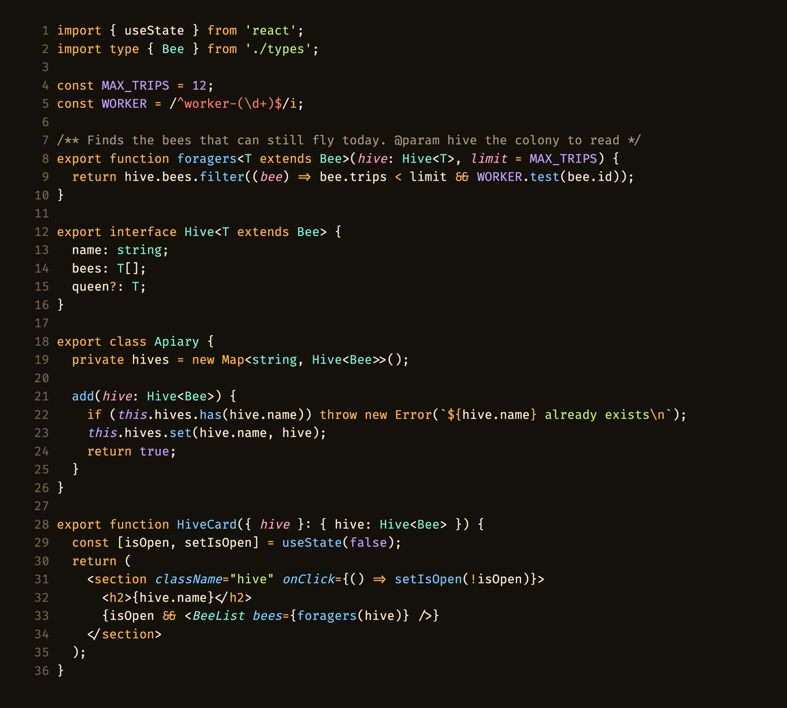
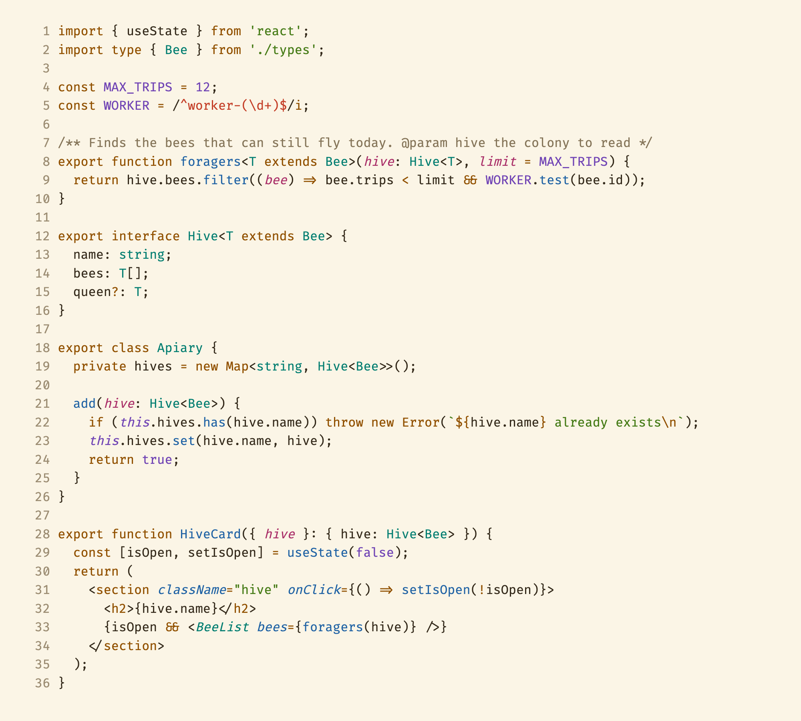

# Favo

A warm theme with the contrast to read code all day. **Favo Honey** for the dark, **Favo Wax** for the light.

Keywords carry the honey color, so a file has a shape before you read a word of it. Each color has one job: sky is what runs, mint is the shape of data, meadow is text, lavender is a fixed value, rose is what was passed in, and coral is a pattern or a problem.

Pick **Favo Honey** or **Favo Wax** with `Preferences: Color Theme`. Language server highlighting and rainbow brackets work out of the box.

The full spec, and Favo for other apps, is at [github.com/irwinarruda/favo-theme](https://github.com/irwinarruda/favo-theme).
